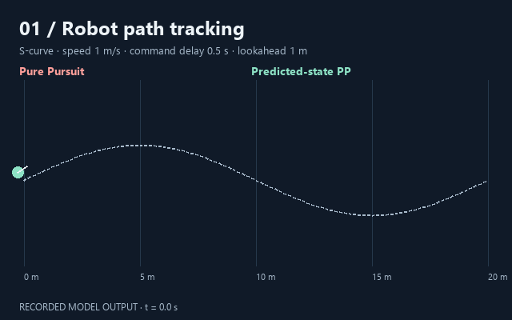

# Episode 1 · Can a robot follow its route?

[中文](EPISODE_01.zh-CN.md) · [English](EPISODE_01.en.md) · [Explore all episodes](https://flessnerchernosky-ops.github.io/robot-delay-lab/showcase.html?lang=en)

**Question: when steering commands arrive late, does command-history prediction always improve path tracking?**



The animation uses saved v0.2 logs: an S-curve, 1 m/s, 0.5 s steering-command delay and 1 m lookahead. It is one illustrative case; the full study includes conditions where prediction makes performance worse.

## What to notice

1. The dashed gray line is the route. Coral is ordinary Pure Pursuit; mint is predicted-state Pure Pursuit.
2. Both controllers share the route, initial state, speed, actual delay and control constraints. The state estimate used for control differs.
3. Compare complete evaluation windows, not a favorable instant. The primary metric covers the first 15 m of route progress, not necessarily the first 15 seconds.

## Reproduce the study

Download the repository and work from its root. Python 3.12 matches the validation environment:

```text
python -m pip install -r requirements.txt
python study.py --out my_results
python linear_analysis.py --out my_results
python plot_study.py --results my_results --gif
python -m unittest -v
```

`my_results` is a separate output directory. Included `results_v02/` files are the 2026-10-09 snapshot. Core simulation uses the standard library; plotting, spectral analysis and the complete tests need the listed dependencies.

[Study settings](study_config.json), [per-trajectory manifest](results_v02/manifest.json) and [paired results](results_v02/paired_comparison.csv) retain both improvements and regressions. The study contains 182 deterministic trajectories and 16 Python checks.

## Make it your own

Copy the configuration and change only lookahead first. Hold route, speed and delay constant; record both controllers’ errors, steering variation and whether the evaluation window completed. Write a hypothesis before running, then explain the result. Separate tuning routes from evaluation routes.

## Limits

A two-dimensional kinematic bicycle model runs at constant speed. Only steering commands are delayed; controllers read current true state. No perception noise, tire slip, collisions or hardware validation is included. v0.2 uses exact constant-input arc updates.

Prediction uses current state and pending commands. Model or delay-estimation errors can worsen results. Deterministic repeats are not independent random experiments; cross-route ranges are not statistical confidence intervals. No algorithmic novelty is claimed.

Continue with the [detailed report, Chinese](REPORT_V02.md), [local stability derivation, Chinese](THEORY.md), [study source](study.py) and [contribution guide](CONTRIBUTING.md).
