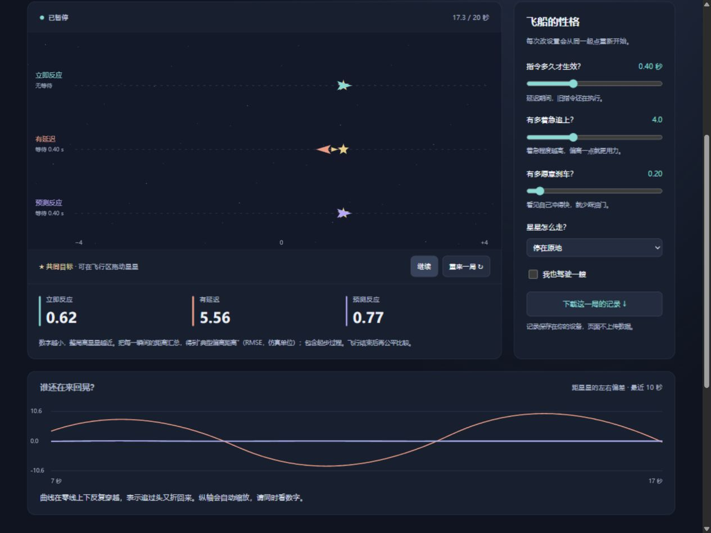

# 第二期：别追过头了——太空追星实验

**不需要先学自动化、控制理论或编程。** 这一期把上一期的小车换成会滑行的飞船：你只要回答一个问题——“我该继续往前推，还是开始刹车？”

**[打开互动实验](https://flessnerchernosky-ops.github.io/robot-delay-lab/)** · [查看实验数据](examples/star_chase_summary.csv) · [回到机器人研究篇](README.md)



## 三分钟怎么玩

1. **轻松靠近。** 三艘飞船一起追一颗停着的星星。没有延迟时，三个自动方法完全同步。注意：不是越快冲到星星旁边，就越容易停住。
2. **越追越晃。** 新指令晚 0.4 秒才生效，飞船却仍然很着急。看看珊瑚色飞船是不是向右冲过头，又向左冲过头。如果飞出画面，边缘会标出真实位置；模型没有把它强行拉回。
3. **学会刹车。** 这一关只改“刹车意愿”，其他条件和上一关相同。观察晃动和整局偏离距离的变化。
4. **星星也会走。** 预测飞船猜星星暂时保持当前速度。但星星会转弯，它的猜测会越来越不准。
5. **预测也会错。** 目标更快地折返。跑完 20 秒，看看紫色飞船的典型偏离距离是不是比珊瑚色更大。

还可以勾选“我也驾驶一艘”，长按左右按钮，或按 A / D、方向键。**松手只是停止推进，不是立刻停住。** 你发出的推进指令也会晚一点生效。这时候，“早点刹车”会成为一种身体直觉。

页面支持手机触控。点击飞行区域并拖动，可以改变星星的位置。暂停时可以拖动目标，再按“继续”观察新的响应。结束后请“重来一局”；每局只记录 20 秒。

## 不看公式也能懂

你打开热水，觉得冷，于是拧热一点；热水还没流过来，你又拧热一点；等它终于到达，水太热了，你赶紧往回拧。**修正动作来得晚，还可能叠加在一起。** 飞船的等待队列把这种现象显出来。

这里有三个关键词：

| 词 | 在这个游戏里是什么意思 |
|---|---|
| 反馈 | 看现在离星星多远、飞得多快，再决定推进多少 |
| 延迟 | 指令已经发出，但要等一段时间才生效；队列里的旧指令仍在执行 |
| 预测 | 根据当前状态和排队的指令，估计新指令生效时的位置 |

这段热水故事只是帮助理解延迟的类比；真实淋浴和航天器都有更复杂的模型。本实验是一个虚构的一维玩具系统。

“有多着急”决定偏离一点时用多大力。“愿意刹车”决定飞得快时减小多少推进力。两者需要配合；把一个滑条推到最高，并不保证每个场景都更好。

## 预测并不是偷看未来

紫色飞船知道自己刚刚发过哪些指令，也知道哪些还没生效。它将这些指令按顺序演算，得到一个预计位置。

对于星星，它只使用**当前的位置和当前速度**，假设星星在这段等待时间内继续直行；预计位置限制在星星允许移动的范围内。它没有调用“未来某时刻星星在哪”的函数，也不知道你接下来会往哪拖。突然转弯时，预测可以失败。

“预测也会错”预设正是一个反例。比较时不要只看某一瞬间距离最近的飞船；等三艘都运行完相同的 20 秒，再看整局指标。

## 五局参考成绩

实验日期：2026-10-10。三艘飞船从同一起点出发，每局运行 2400 步、共 20 秒。下面是“典型偏离距离”RMSE（仿真单位），保留了起步过程；不是胜率，也不是统计置信区间。

| 关卡 | 立即反应 | 有延迟 | 预测反应 |
|---|---:|---:|---:|
| 轻松靠近 | 0.553 | 0.553 | 0.553 |
| 越追越晃 | 0.574 | 6.024 | 0.714 |
| 学会刹车 | 0.522 | 0.894 | 0.673 |
| 星星也会走 | 0.645 | 3.047 | 0.810 |
| 预测也会错 | 1.021 | 0.886 | 1.181 |

最后一局中，预测反而增大了约 33.3% 的整局偏离距离。立即反应也没有取得最低分：有限推进力、目标运动频率和响应相位都会影响这个分数。这几组刻意选择的教学案例，不能证明某种方法普遍更好。

精确数值见 [汇总 CSV](examples/star_chase_summary.csv)；“越追越晃”完整记录见 [2400 步轨迹 CSV](examples/star_chase_chaos.csv)。浏览器和这些示例使用同一份计算引擎和关卡配置。

## 带走自己的实验

新增 **[15 分钟学习路线](LEARNING_MISSIONS.md)**。页面下方“我的实验笔记本”可以保存完整运行 20 秒的成绩和你填写的文字，最多 12 条；比较原设置与新设置，并下载 Markdown 笔记。只存在当前页面内，刷新、关闭后会丢失，请及时下载。保存后的文字不会随输入框变化；开始下一局前记得更新猜测与解释。

笔记本只保存成绩摘要，完整轨迹请逐局另外下载 CSV。对照工具要求同一种自动目标、手动驾驶关闭，一次只改变一个参数；拖动星星和手动操作可以记录，但不能作为同条件的参数对照。

点击“下载这一局的记录”。CSV 会保存实际运行时长、参数、目标位置与速度，以及各飞船的位置、速度、计算指令和真正执行的指令。不到 20 秒就下载的是部分记录，不能与完整一局的分数直接混比。

一张容易写的小实验表：

| 我的改动 | 我的猜测 | 原设置的整局分数 | 新设置的整局分数 | 我现在的解释 |
|---|---|---|---|---|
| 只增加延迟 | 我猜会更晃 | 待填写 | 待填写 | 待填写 |
| 只增加刹车意愿 | 我猜会少追过头 | 待填写 | 待填写 | 待填写 |
| 改成快速折返 | 我猜预测更难 | 待填写 | 待填写 | 待填写 |

拖动目标、手动驾驶时，你自己的操作也会影响成绩。要比较参数，先使用同一关卡、同一目标运动方式，关闭手动驾驶，一次只改一个变量。

## 下载后离线玩

在仓库点 **Code → Download ZIP**，解压后双击 `docs/index.html`，即可在现代浏览器离线玩。请一起保留同目录的 `engine.js`、`notebook.js`、`app.js` 和 `style.css`。GitHub 的代码预览页只展示源文件，不会直接运行 HTML；使用上面的互动实验链接或离线打开。

如果你会一点 Node.js，还可以独立重复检查和数据：

```text
node checks/star_lab.cjs
node checks/notebook.cjs
node checks/star_examples.cjs
```

前两条运行 10 项模型与复现检查、4 项笔记本检查，第三条重新生成 `examples/` 中的教学实验数据。浏览器运行不需要安装 Node.js。

## 想继续深挖，再看这一段

- 位置和速度是两个状态，推进力改变速度；固定微弱阻力使无推进时的速度逐渐降低。每一步使用恒定输入的解析更新。
- 自动指令 = “着急程度 × 位置偏差” − “刹车系数 × 速度”。刹车系数设为 `2 × 刹车意愿 × sqrt(着急程度)`；这是教学用的 PD 控制形式。
- 推进力限制为 ±6，阻力系数为 0.15；位置没有硬边界。画面显示 −4 到 +4，飞出时显示真实数值；图表纵轴自动缩放。
- 仿真步长为 1/120 秒。输入延迟取整到步数，每次先计算新指令，再取出应生效的旧指令，推进状态。
- 立即反应与有延迟使用同一控制公式。预测方法通过当前状态、待执行历史指令和目标的当前速度改变控制所用的位置估计。
- 每条记录对应一步结束，目标列是这一步保持的目标指令。目标巡游每步重新采样；浏览器刷新率改变播放速度时，计算步长不变。
- 预测使用与玩具飞船完全一致的模型；这里没有模型误差、感知延迟、测量噪声、随机通信抖动或碰撞。请不要将教学动画当成真实机器人或航天器性能证明。

## 和上一期有什么关系

上一期研究的是小车的**转向指令延迟**，这一期换成飞船的**推进指令延迟**。共同的问题仍然是：纠正动作来晚以后，会发生什么？历史指令能不能帮助提前估计状态？

这一期的价值是把研究问题讲清楚，并提供可重复的互动演示；它不是新的算法贡献。项目由 AI 协助制作，适合作为你继续理解、修改和记录自己发现的起点。
