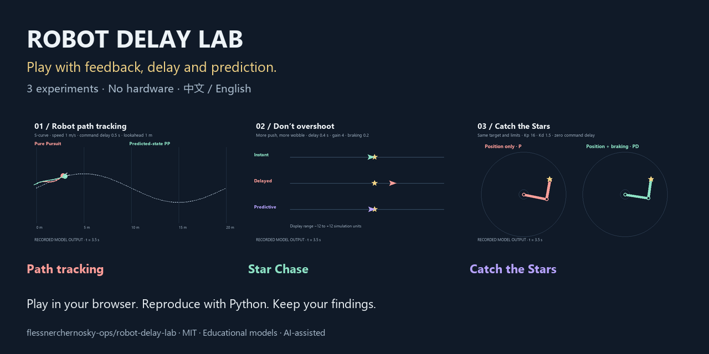
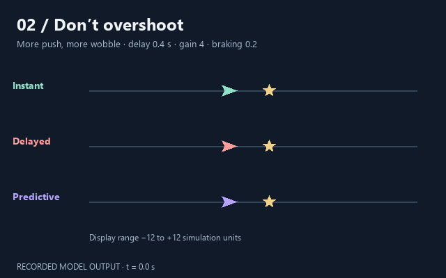
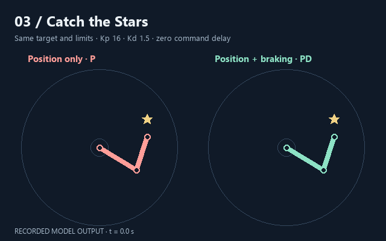

# Robot Delay Lab · Play with control

[中文](README.md) · [English](README.en.md)

**Why can trying harder make you overshoot?** Explore feedback, delay, prediction and reachability with a robot car, spacecraft and arm.

**[Explore all three episodes →](https://flessnerchernosky-ops.github.io/robot-delay-lab/showcase.html?lang=en)** · [Star Chase](https://flessnerchernosky-ops.github.io/robot-delay-lab/?lang=en) · [Catch the Stars](https://flessnerchernosky-ops.github.io/robot-delay-lab/arm/?lang=en)



Two mobile-friendly, bilingual browser playgrounds require no hardware, installation or control-theory background. Episode 1 is a reproducible Python study. Pages contain no tracking or experiment uploads. MIT licensed.

| Pick a question | Explore | Start |
|---|---|---|
| ① Can a robot follow its route? | Pure Pursuit vs predicted-state control, delay sensitivity and local stability | [English guide](EPISODE_01.en.md) / [中文](EPISODE_01.zh-CN.md) |
| ② Why does chasing harder make you wobble? | Command delay, braking, manual flight and failed prediction | [Play now](https://flessnerchernosky-ops.github.io/robot-delay-lab/?lang=en) / [Guide](EPISODE_02.en.md) |
| ③ It looks close. Why can’t the arm catch it? | Drag targets, compare P / PD, explore joint limits and reachability | [Play now](https://flessnerchernosky-ops.github.io/robot-delay-lab/arm/?lang=en) / [Guide](EPISODE_03.en.md) |

## ① Robot path tracking · Is prediction always better?


Compare ordinary Pure Pursuit and command-history predicted-state control in a two-dimensional kinematic bicycle model. v0.2 includes **182 deterministic trajectories and 16 Python checks**, five routes, three speeds, model/delay estimation errors and discretization diagnostics.

Prediction does not improve every condition. The animation is one S-curve case at 1 m/s with 0.5 s delay. The [detailed report, Chinese](REPORT_V02.md) retains improvements and regressions; [local stability analysis, Chinese](THEORY.md) states the derivation and assumptions.

[English reproduction guide](EPISODE_01.en.md) · [中文指南](EPISODE_01.zh-CN.md) · [Source](study.py) · [Paired scores](results_v02/paired_comparison.csv)

## ② Star Chase · Don’t overshoot



**Three spacecraft, five scenarios, 20 seconds per run.** Compare instant, delayed and predictive responses; fly manually, inspect error curves and export CSV. Prediction estimates future states without seeing future targets. Fast reversals provide a counterexample where prediction is worse.

Chinese/English UI, a [15-minute learning path](LEARNING_MISSIONS.en.md) and a notebook help you write a hypothesis, finish a run and check controlled comparisons. Up to 12 notes stay in the page; refreshing clears them, so download before leaving.

[Play in English](https://flessnerchernosky-ops.github.io/robot-delay-lab/?lang=en) · [中文试玩](https://flessnerchernosky-ops.github.io/robot-delay-lab/?lang=zh) · [English guide](EPISODE_02.en.md) · [中文指南](EPISODE_02.md) · [Source](docs/engine.js)

## ③ Catch the Stars · Approach, then stop



**Two links, two strategies, 12 seconds per run.** Five challenges explore reachability, overshoot, delayed commands, joint limits and moving targets. Drag the star, tune parameters, compare P and PD, and download full trajectories and personal notes.

Includes **31 configuration entries (with repeated baselines), 62 deterministic trajectories**, 15 model checks and independent Python sampled-linear-system verification. Stronger braking or prediction does not guarantee better performance in every scenario.

[Play in English](https://flessnerchernosky-ops.github.io/robot-delay-lab/arm/?lang=en) · [中文试玩](https://flessnerchernosky-ops.github.io/robot-delay-lab/arm/?lang=zh) · [English guide](EPISODE_03.en.md) · [中文指南](EPISODE_03.zh-CN.md) · [Source](docs/arm/engine.js)

## Make the experiment yours

Write a question and hypothesis, hold the target fixed, change one parameter, finish a full run, then download data and notes. Deterministic repeats are not independent random trials. Dragged targets are free play, not controlled parameter comparisons.

**Research limits:** simplified teaching and study models without real hardware validation or claims of new control algorithms. Episode 1 omits perception noise and tire slip; Episode 2 is a fictional one-dimensional spacecraft; Episode 3 omits gravity, joint coupling, collisions and grippers. See each guide for assumptions.

Found it useful? **Star the repository** to keep it handy. Report problems or contribute through the [bilingual contribution guide](CONTRIBUTING.md). [Sharing text and media](SHARING.md) are available in both languages. AI-assisted: distinguish presets from experiments you personally performed.

---

## Detailed reproduction notes for Episode 1

### Reproduce v0.2

Core simulation uses Python standard library. Plotting, matrix spectra and the complete test suite need the dependencies listed in `requirements.txt`. Python 3.12 matches the validation environment.

```text
python study.py
python -m pip install -r requirements.txt
python linear_analysis.py
python -m unittest -v
python plot_study.py --gif
python build_report.py
```

Without NumPy, four linear-model tests explicitly skip. `study_config.json` contains study settings; `results_v02/manifest.json` records each trajectory’s settings and `paired_comparison.csv` includes both improvements and regressions. Cross-route ranges are not statistical confidence intervals. Included study results are dated 2026-10-09. Use `--out` to preserve them, and matching `--results` options for plots and reports; `build_report.py --date` sets the actual experiment date.

### Original baseline

```text
python simulate.py
python -m unittest -v
python -m pip install -r requirements.txt
python plot_results.py --gif
```

To write a separate experiment:

```text
python simulate.py --config config.json --out results_experiment_01
python plot_results.py --results results_experiment_01 --gif
```

Default conditions: 0.02 s step, 1 m/s constant speed, 0.5 m wheelbase, 1 m route lookahead, ±35° steering, 0.5 m initial cross-track offset, and delays of 0/0.2/0.5/0.8 s. Maximum duration is 60 s; primary tracking metrics cover the first 15 m of route progress. Settings are saved with each experiment.

The model uses `x'=v*cos(yaw)`, `y'=v*sin(yaw)`, `yaw'=v/L*tan(delta)`. The original baseline uses forward Euler; v0.2 uses exact constant-input arc updates. Pure Pursuit projects onto the route and selects a target by along-route lookahead, then computes steering from its vehicle-frame lateral offset and Euclidean distance. See [Coulter’s original report](https://publications.ri.cmu.edu/implementation-of-the-pure-pursuit-path-tracking-algorithm).

Only steering commands are delayed. Controllers read current true state. There is no perception delay, noise, actuator dynamics, tire slip or collision model, and speed is not delayed. Delays must be integer multiples of the simulation step.

`rmse_m` and `max_error_m` include the initial transient over the evaluation interval. Check `evaluation_reached`, `completed` and `evaluation_duration_s` as well: a failed run may cover less distance. RMSE is time sampled, not distance averaged. Included v0.1 results reach the evaluation distance in all 12 cases, with 11 completions; one high-delay straight-route case fails the terminal condition. These deterministic results have no statistical confidence intervals.

### Main study files

| File | Purpose |
|---|---|
| `simulate.py`, `config.json` | Baseline model, delay queue, routes and settings |
| `study.py`, `study_config.json` | v0.2 experiment generation |
| `linear_analysis.py`, `THEORY.md` | Local sampled-system spectra and derivation |
| `plot_study.py`, `build_report.py` | Study figures, animations and report |
| `plot_results.py` | Baseline figures and animation |
| `test_simulate.py`, `test_study.py` | Model, prediction and linear-analysis checks |
| `LEARNING.md`, `REPORT.md`, `REPORT_V02.md` | Earlier learning and research materials, Chinese |

## References and contributions

[PythonRobotics](https://github.com/AtsushiSakai/PythonRobotics) and [Robotics Toolbox for Python](https://github.com/petercorke/robotics-toolbox-python) inform the arm module’s teaching approach. Its simplified implementation is original, with no copied upstream code or runtime dependencies on these repositories.

For issues, include full settings, interface language, exported CSV and expected/actual behavior. Contributions should preserve fair comparisons, reproducible parameters and explicit limitations. Stars can help people discover the project; they are not evidence of research novelty or validation.
