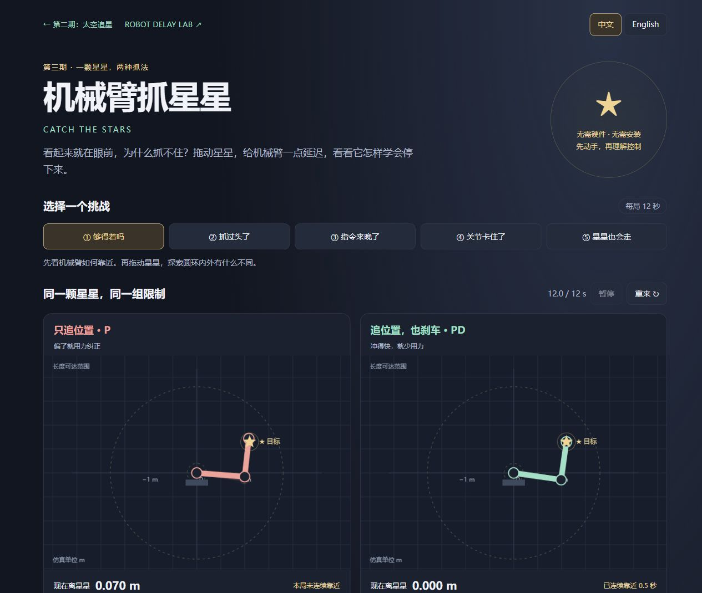
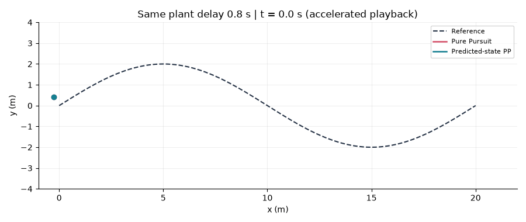
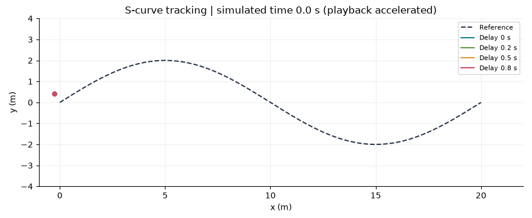
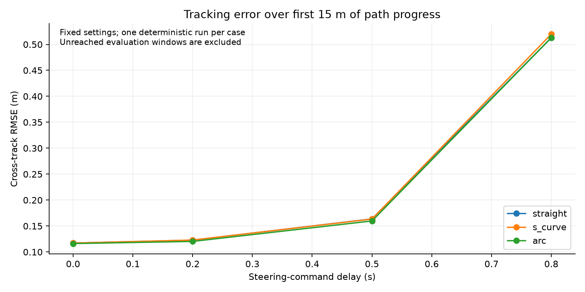

# Robot Delay Lab

[中文](README.md) · [English](README.en.md)

## 第三期 · 机械臂抓星星

**[在线试玩：机械臂抓星星 / Catch the Stars](https://flessnerchernosky-ops.github.io/robot-delay-lab/arm/)**——打开浏览器，让两种策略抓同一颗星星：只追位置的 P，以及会根据速度刹车的 PD。五个挑战包括够得着吗、抓过头了、指令来晚了、关节卡住了和移动目标。无需硬件或安装，界面支持中文 / English。

可拖动目标、调整参数、下载完整 CSV、保存自己的实验笔记，并检查两局是否只改变了一个变量。项目提供 31 组配置条目（含重复基线）、62 条确定性轨迹的成绩与设置快照；15 项模型检查及 Python 独立离散线性系统校验。

[中文模型与复现说明](EPISODE_03.zh-CN.md) · [English model and reproduction guide](EPISODE_03.en.md) · [实验成绩](examples/arm/summary.csv) · [模型源码](docs/arm/engine.js)

这是一种独立关节伺服教学模型，未包含重力、关节耦合、碰撞、抓手或实物验证。结果用于理解与对照实验，不能直接用于真实机械臂。




## 第二期 · 零基础也能玩

新增 [15 分钟学习路线](LEARNING_MISSIONS.md) 与页面内的实验笔记本：保存完整一局的成绩、比较只改一个变量的结果、下载自己填写的 Markdown 笔记。

**[别追过头了：太空追星实验](https://flessnerchernosky-ops.github.io/robot-delay-lab/)**——把小车换成会滑行的飞船，亲手体验反馈、延迟和预测。五个关卡、手动驾驶、偏差曲线和 CSV 下载，不需要控制理论基础，也不需要安装软件。

[完整玩法与实验记录](EPISODE_02.md) · [互动页面源码](docs/) · 下载 ZIP 后也可双击 `docs/index.html` 离线玩。


## 第一期 · 机器人研究篇

研究问题：转向指令存在延迟时，Pure Pursuit 控制器何时出现振荡？基于命令历史的预测补偿在什么条件下有利，付出什么代价？

这是一个面向本科阶段的机器人控制实验起点。用二维运动学自行车模型，比较直线、S 形和圆弧路线，在固定参数下的延迟响应。核心仿真只需要 Python 3.10 或更新版本，没有硬件要求。

**当前版本：v0.2，预测补偿对照、参数敏感性及局部稳定性分析。** 本轮已有 182 条确定性仿真轨迹和 16 项自动检查，包含 5 条路线、3 个速度、模型/延迟估计误差和离散化诊断。原始 v0.1 的 12 组结果保留在 `results/`。尚未加入 MPC、随机噪声或实物验证。

本轮核心发现是“预测补偿并非处处降低误差”。具体改善、退化和分析边界见 [v0.2 实验报告](REPORT_V02.md)，理论推导见 [局部稳定性说明](THEORY.md)。这些是学习与研究成果，尚未确认算法新颖性。



## 运行 v0.2 研究

核心仿真使用 Python 标准库；绘图和特征值分析需要第三方库。建议使用 Python 3.12，与本次验证环境一致。所有命令均在项目目录执行：

```powershell
python study.py
python -m pip install -r requirements.txt
python linear_analysis.py
python -m unittest -v
python plot_study.py --gif
python build_report.py
```

如果暂时不安装依赖，第一条命令仍能生成全部轨迹日志、配置快照和配对比较。完整自动检查需要 NumPy；缺少 NumPy 时，四项线性模型检查会明确显示跳过。

`study_config.json` 是研究设置入口，`results_v02/manifest.json` 为每条轨迹保存完整设置，`results_v02/logs/` 保存原始时序，`paired_comparison.csv` 保留正负结果。图中的跨路线范围不是统计置信区间。

后续运行可以用 `--out` 指定其他目录，绘图和报告对应使用 `--results`。新版报告可通过 `--date` 指定实际实验日期。附带结果是 2026-10-09 的实验快照。

## 第一版与新版的区别

| 内容 | v0.1 | v0.2 |
|---|---|---|
| 控制器 | 普通 PP | 普通 PP、预测状态 PP |
| 仿真更新 | 欧拉 | 主研究用恒定输入的精确圆弧更新 |
| 路线/速度 | 3 条、1 个 | 主比较 5 条、3 个 |
| 对照 | 延迟扫描 | 延迟、前视距离、估计/模型误差、离散化 |
| 理论 | 算法说明 | 连续局部边界、采样增广矩阵及预测谱关系 |
| 数据 | 12 组 | 本轮 182 组，不含线性矩阵谱扫描 |

下方说明保留第一版入门方法。第一版默认仍使用欧拉法，因此其数值与采用精确更新的新版不会完全相同。



## 快速运行

在这个项目文件夹中打开终端：

```powershell
python simulate.py
python -m unittest -v
```

第一条命令生成 `results/summary.csv` 和每组实验的逐时刻日志。第二条命令验证直线运动、转向方向、指令延迟和重复运行的一致性。

绘图是独立步骤；即使没有绘图库，也可以完成仿真：

```powershell
python -m pip install -r requirements.txt
python plot_results.py --gif
```

默认输出目录已附带本次运行的结果。若要保留它们，把新实验写到另一个目录：

```powershell
python simulate.py --config config.json --out results_experiment_01
python plot_results.py --results results_experiment_01 --gif
```

## 默认实验条件

| 参数 | 数值 |
|---|---:|
| 仿真步长 | 0.02 s |
| 速度 | 1 m/s，保持不变 |
| 轴距 | 0.5 m |
| 沿参考路线的前视距离 | 1 m |
| 转向角限制 | ±35° |
| 初始横向偏差 | 0.5 m |
| 转向指令延迟 | 0、0.2、0.5、0.8 s |
| 最长运行时间 | 60 s |
| 主要误差指标的评估范围 | 每条路线从起点到首次到达 15 m 路径进度 |

所有参数保存在 `config.json`，每次运行会把实际使用的配置复制到结果目录的 `config_used.json`。

## 模型和控制方法

小车状态 `(x, y, yaw)` 对应后轴中心的位置和朝向，`v` 是速度，`L` 是轴距，`delta` 是转向角。运动方程为：

```text
dx/dt   = v * cos(yaw)
dy/dt   = v * sin(yaw)
dyaw/dt = v / L * tan(delta)
```

使用前向欧拉法推进状态。参考路线是 201 个点组成的折线，横向误差是当前位置到这条折线的最短距离。

控制器先将小车位置投影到参考路线，找到沿路线向前一个 `lookahead` 的目标点。将该目标点转换到车体坐标系，令其横向坐标为 `y_local`、与小车的实际距离为 `d`：

```text
curvature = 2 * y_local / d**2
delta = atan(L * curvature)
```

再对转向角限幅。这里沿路线的前视距离与目标点的欧氏距离并不完全相同，计算曲率时使用实际欧氏距离。

Pure Pursuit 的几何原理可参考 [Coulter, 1992, Implementation of the Pure Pursuit Path Tracking Algorithm](https://publications.ri.cmu.edu/implementation-of-the-pure-pursuit-path-tracking-algorithm)。本项目从这些公开原理出发编写简化实现，路线生成、延迟队列、日志和实验评估是当前实验框架的组成部分。

## 延迟究竟作用在哪里

本项目模拟的是**转向指令传输延迟**：第 `k` 步算出的转向指令，在第 `k + N` 步才作用到小车。`N = delay / dt`，延迟必须是步长的整数倍。尚无指令到达时，转向角为零。

控制器每一步读取的是当前真实状态。这里没有模拟感知延迟、噪声、转向执行器动力学、打滑或碰撞。速度指令也没有延迟。因此结果应理解为这个特定模型的响应。

## 如何读结果



- `rmse_m`：前 15 m 路径进度范围内，横向误差的均方根，单位为米。保留初始偏差带来的瞬态。
- `max_error_m`：同一评估范围内的最大横向误差。
- `evaluation_reached`：是否真的走完了评估范围。为 False 的情况不能当作完整范围的成绩。
- `completed`：是否在 60 s 内进入终点 0.3 m 范围，且投影进度距离路线末端不超过 0.3 m。
- `duration_s`：到达终点或超时的仿真时长。
- `full_run_rmse_m`：整次运行的误差，包括终点附近的行为，失败时包含整个超时过程。

使用前 15 m 评估可以减少终点处理的影响。每组实验的时长仍可能不同，所以同时保留 `evaluation_duration_s`；当前分数是等时间采样的 RMSE，不能解释为等路程采样的 RMSE。

原始第一版的 12 组实验都走完了 15 m 的评估范围，11 组满足终点判定。直线路线的 0.8 s 延迟实验没有满足终点判定；其固定速度和终点追踪行为需结合完整轨迹分析。

这些是单次确定性实验，没有统计置信区间。结论只针对当前模型、路线和参数。

## 文件说明

| 文件 | 用途 |
|---|---|
| `simulate.py` | 路线、小车模型、Pure Pursuit、延迟队列和日志 |
| `config.json` | 可以修改的实验参数 |
| `study.py` / `study_config.json` | v0.2 实验生成及设置 |
| `linear_analysis.py` / `THEORY.md` | 局部谱扫描与推导 |
| `plot_study.py` | 新版结果图和对比动画 |
| `build_report.py` / `REPORT_V02.md` | 从 CSV 生成新版报告 |
| `plot_results.py` | 从已保存的日志生成图和动画 |
| `test_simulate.py` | 检查基础物理行为和延迟语义 |
| `test_study.py` | 预测、模型雅可比和局部谱检查 |
| `LEARNING.md` | 按顺序阅读代码和完成练习 |
| `REPORT.md` | 本次基线实验结果与局限 |
| `results/` | 参数快照、CSV 日志、PNG/SVG 和 GIF |
| `results_v02/` | 新版完整记录与结果 |

## 后续研究路线

1. 阅读代码并独立重复结果；修改前视距离，解释曲线变化。
2. 检查数值误差：减小步长，增加路线采样密度，观察结果是否稳定。
3. 在独立路线集上比较前视距离的取值，分开调参场景与评估场景。
4. 比较两种控制器在相同调参预算下的表现，再考虑增加 MPC 等方法。
5. 若加入随机噪声，记录随机种子并重复实验，报告结果分布。
6. 在报告中区分已有算法、个人实验设计、改动及失败案例。

当前项目是学习和研究基线，尚未建立新的算法贡献或论文级结论。后续可以结合校内导师的研究方向收窄问题。

## 参考和许可

- [Pure Pursuit 原始技术报告](https://publications.ri.cmu.edu/implementation-of-the-pure-pursuit-path-tracking-algorithm)
- [PythonRobotics：更多算法示例](https://github.com/AtsushiSakai/PythonRobotics)

本项目代码使用 MIT License，见 `LICENSE`。参考项目有各自的许可证；后续如果引入第三方代码，需要保留其许可和来源。
