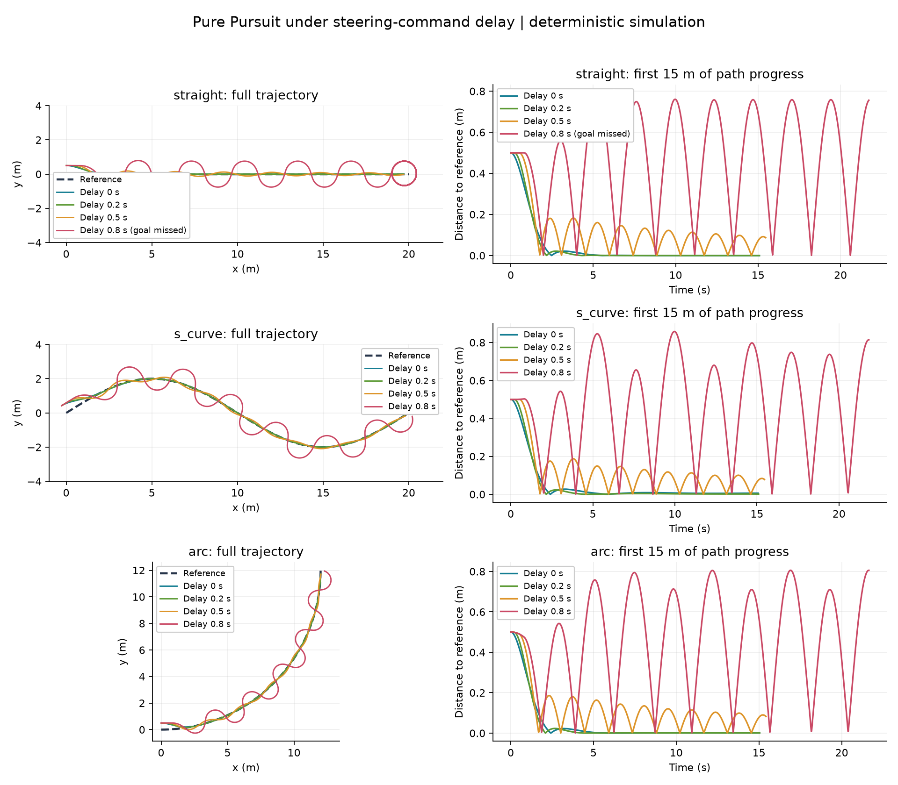

# 基线实验记录：2026-10-09

## 问题与设置

在固定速度、轴距、转向角限制和前视距离下，测量转向指令延迟对 Pure Pursuit 跟踪表现的影响。共有 3 条路线 × 4 个延迟条件，12 组确定性实验。完整配置见 `results/config_used.json`。

每次从路线起点沿左法线偏移 0.5 m，初始朝向与第一段路线一致。主要指标是首次到达 15 m 路径进度之前的等时间采样横向 RMSE。每条路线的投影、目标点选择和终点规则一致。

## 结果

单位：米。数值由 `results/summary.csv` 四舍五入至 4 位小数。

| 路线 | 0 s 延迟 | 0.2 s 延迟 | 0.5 s 延迟 | 0.8 s 延迟 |
|---|---:|---:|---:|---:|
| 直线 | 0.1172 | 0.1228 | 0.1637 | 0.5128 |
| S 形 | 0.1172 | 0.1229 | 0.1634 | 0.5200 |
| 圆弧 | 0.1162 | 0.1204 | 0.1598 | 0.5129 |

全部实验到达了 15 m 评估范围。终点判定完成 11 组；直线、0.8 s 延迟这一组在 60 s 内未满足终点判定。

在所测试的四个延迟取值及当前参数下，三条路线的 RMSE 随延迟增加而增加。0.8 s 的轨迹出现明显振荡。当前数据没有定位临界延迟，也不能确定连续变化的延迟范围内必然单调。

## 解释边界

- 无延迟时仍有误差，部分来自初始 0.5 m 偏差；还包括路线弯曲、有限前视距离和离散化的影响。尚未通过分离实验量化各部分贡献。
- 失败实验的全程 RMSE 含有更长的终点附近行为，不能与成功实验直接混同。前 15 m 指标和完成状态应一起报告。
- 固定速度和简化的终点追踪可能影响完成状态，后续应单独研究终点减速与停靠。
- 当前延迟仅作用于转向指令，不是整个机器人系统的综合延迟。
- 当前只有一个控制器，尚无算法优劣比较或创新性证明。
- 应继续检查步长和路线采样密度，验证曲线对离散化的敏感性。
- 没有随机噪声，因此重复同一配置不会产生用于统计推断的独立随机样本。
- 本模型和仿真结果尚未用实物验证。

## 验证

本机运行了 12 组实验并完成全部日志与图像生成。5 项自动检查通过，涵盖直线运动解析解、转向符号、延迟脉冲时序、直线零误差平衡/确定性和不合法延迟设置。

这些检查验证基础实现行为，不构成算法稳定性证明。

## 下一步

先完成 `LEARNING.md` 中的前视距离实验和离散化检查。之后与导师讨论，决定研究参数设计、延迟补偿，或增加第二种控制器。当前结果作为后续工作的基线保存。
